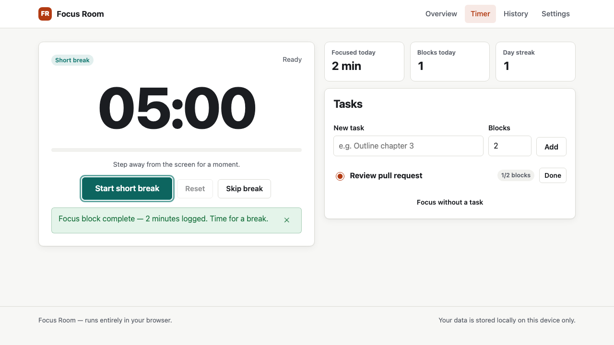
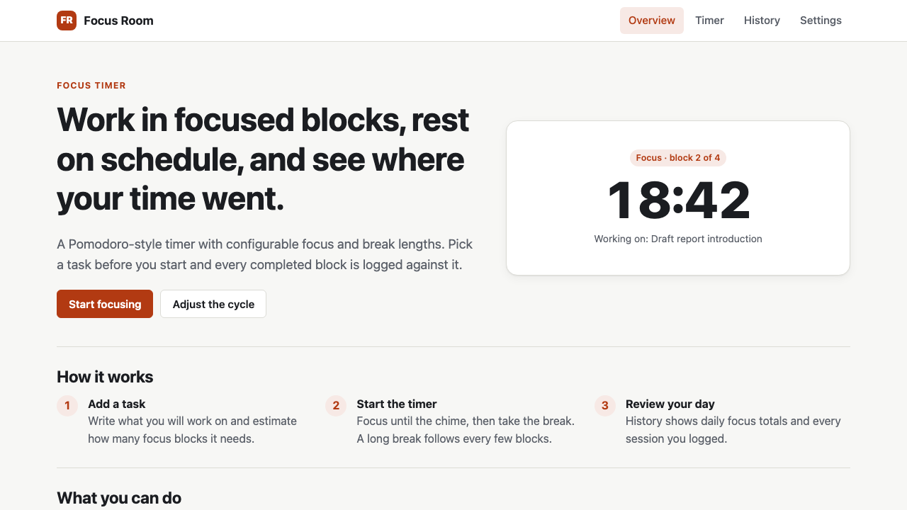

# Focus Room

A Pomodoro-style focus timer. Configure focus and break lengths, pick a task, run focus blocks, and review daily focus totals and session history.



| Mobile | Landing |
| --- | --- |
|  |  |

## Run it

```bash
npm install
npm run dev        # http://localhost:5104
npm test
npm run build
npm run test:e2e   # Playwright smoke test (npm run e2e:install once if Chromium is missing)
```

## Main workflow

1. **Settings** (optional) → focus length, short/long break lengths, blocks before a long break, auto-start, chime.
2. **Timer** → add a task with an estimate of focus blocks; it becomes the active task.
3. **Start focus**. Pause/resume with the button or the **Space** key. When the block ends, it is logged against the task, the task's block count goes up and the timer moves to a break (a long break after the configured number of blocks).
4. **Finish early** logs the whole minutes worked so far (refused with a message if under one minute). **Reset** discards the current block.
5. **History** → seven-day bar chart of focused minutes and a table of sessions (completed vs ended early).

Demo content: **History → Load demo history** (only shown when history is empty) adds a week of labelled sample sessions.

## Design notes

- The timer stores an absolute end time, so it stays accurate when the tab is in the background or the page is reloaded mid-block.
- `src/lib/timer.ts` is a pure state machine (start / pause / advance / reset); `src/lib/history.ts` computes totals and streaks.
- The page title shows the remaining time while running.

## Tests

- `src/lib/timer.test.ts` — pause accuracy, completion detection, short/long break cycle, auto-start, clock formatting, settings validation, daily totals, day streaks, task validation.
- `src/App.test.tsx` — settings validation/success, a complete focus block with fake timers (logged once, task count updated), early-finish refusal, empty history.
- `e2e/smoke.spec.ts` — uses Playwright's clock to run a real 2-minute block in the production build, including keyboard pause, then checks history and the 375px layout.

A real bug was caught by the component test: the completion handler could log the same block several times if the interval fired again before React re-rendered. It is now guarded.

## Limitations

- No system notifications; the alert is an on-page message plus an optional chime (browsers may block audio until you interact).
- If the tab is closed when a block ends, the block is logged the next time the timer page runs, not at the exact moment.
- Session history shows the latest 50 rows; there is no export yet.

## Future improvements

- Optional browser notifications (with permission prompt).
- CSV export of sessions and per-task time reports.
- Edit or delete individual sessions.
