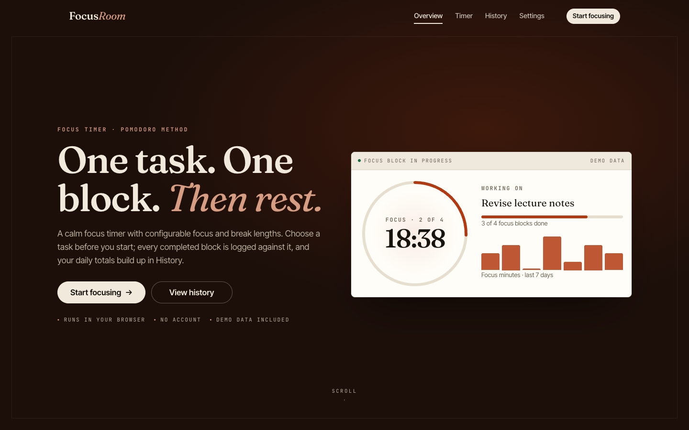
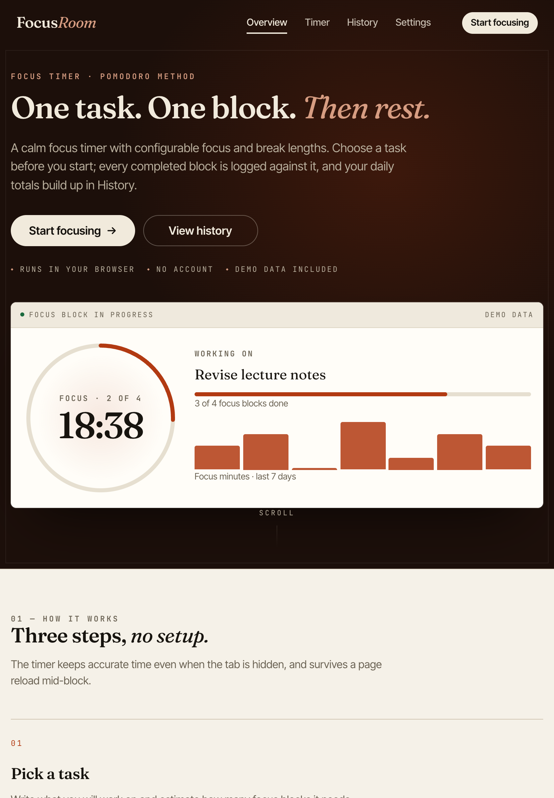
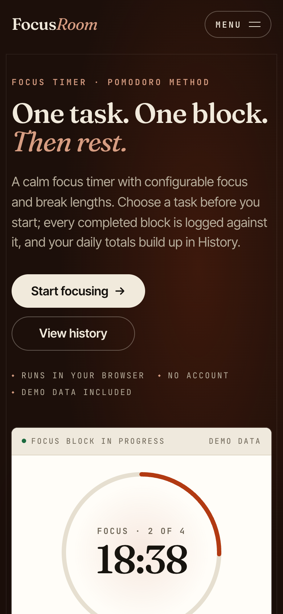
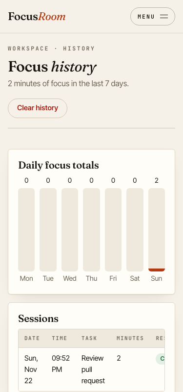

# Focus Room

<!-- screenshots:start -->
<p align="center">
  
</p>
<p align="center">
  
  &nbsp;&nbsp;
  
</p>
<p align="center"><sub>Mac (1440×900) · Tablet (820×1180) · Phone (390×844)</sub></p>
<!-- screenshots:end -->

A calm Pomodoro-style focus timer. Configure focus and break lengths, pick a task, run focus blocks inside a progress ring with a clear in-session state, and review daily focus totals and session history.

**Live demo:** [https://kavishtolani.github.io/focus-room/](https://kavishtolani.github.io/focus-room/) — runs entirely in your browser; demo data is fictional and labelled.


| Timer | Mobile |
| --- | --- |
|  |  |

## Run it

```bash
npm install
npm run dev        # http://localhost:5104
npm test
npm run build
npm run test:e2e   # Playwright smoke test (npm run e2e:install once if Chromium is missing)
```

## Main workflow

1. Opens with labelled demo tasks (including a very long title and a finished task) and a week of demo sessions (including early finishes). **History → Clear demo sessions** shows the empty state.
2. **Settings** → focus / short / long break lengths, blocks before a long break, auto-start, chime. Out-of-range values are rejected and nothing is saved.
3. **Timer** → add or choose a task, **Start focus**. Space pauses/resumes. When the block ends it is logged once, the task count goes up and a break begins (long break after N blocks).
4. **Finish early** logs whole minutes worked (refused under one minute). **Reset** discards the block.
5. **History** → seven-day chart of focused minutes and a session table (completed vs ended early).

## Design notes

- Shared editorial system with Fraunces display type; the hero preview is a real countdown driven by the same timer state machine as the app.
- Active state: the ring fills, a slow “breathing” glow runs only while a block is running, the card gains an accent outline, the heading changes to “In focus” and the page title shows the remaining time. The glow is disabled under `prefers-reduced-motion`.
- The timer stores an absolute end time, so it stays accurate in background tabs and across reloads.

## Tests

- `src/lib/timer.test.ts` — pause accuracy, completion detection, break cycle, auto-start, clock formatting, settings validation, daily totals, streaks, task validation.
- `src/App.test.tsx` — settings validation/success, a full focus block with fake timers (logged exactly once), early-finish refusal, demo and empty history.
- `e2e/smoke.spec.ts` — Playwright clock runs a real 2-minute block in the production build with keyboard pause, then checks history and the 375px layout.

## Limitations

- No system notifications; on-page message and optional chime only.
- A block that ends while the tab is closed is logged when the timer page next runs.
- History shows the latest 50 rows; no export yet.

## Future improvements

- Optional browser notifications; CSV export; editing individual sessions.

## Licence

MIT — see [LICENSE](LICENSE).
